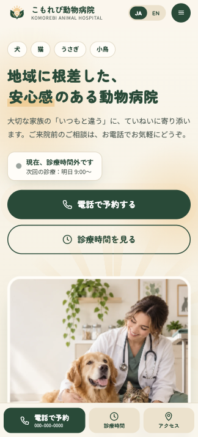

# Portfolio - Komorebi Animal Hospital

# Over View / 概要

HTML・CSS・JavaScriptの学習を目的として制作した、架空の動物病院「こもれび動物病院」のWebサイトです。

地域に根差した動物病院をコンセプトに、飼い主と動物が安心して利用できる、温かみのあるデザインを目指しました。診療時間や診療内容、スタッフ紹介など、来院前に必要な情報を分かりやすく伝える構成にしています。

*A fictional animal hospital website created for learning and demonstrating HTML, CSS, and JavaScript skills.*

*The website features a warm, welcoming design focused on building trust with pet owners and providing clear information about veterinary services.*

---

## URL

https://turi-kip.github.io/portfolio-hospital001/

---

## Technologies Used / 使用技術

- HTML
- CSS
- JavaScript

---

## Features / 工夫した点

- Responsive design for desktop and mobile devices.
  - PC・スマートフォンの両方に対応したレスポンシブデザイン

- Bilingual support for Japanese and English.
  - 日本語と英語の2言語に対応した表示切り替え機能

- Clear presentation of opening hours and temporary closures.
  - 診療時間・休診日・臨時休診のお知らせを分かりやすく表示

- Dedicated emergency care information.
  - 急患時の連絡方法や対応方針を確認できる案内セクション

- Organized veterinary services and preventive care information.
  - 一般診療・予防医療・健康診断などの診療内容を整理して紹介

- Staff profiles with professional backgrounds and care philosophies.
  - スタッフの経歴や診療に対する考え方を紹介するプロフィールセクション

- Information about the animals treated at the hospital.
  - 犬・猫・うさぎ・小鳥など、対応する動物についての情報を掲載

- Step-by-step guidance for first-time visitors.
  - 初診の方が安心して来院できるよう、受診の流れや必要な情報を案内

- Easy navigation to important information, including appointments and access.
  - 予約・診療案内・アクセスなど、必要な情報へ移動しやすいナビゲーション

- Warm and approachable visual design to create a sense of trust and comfort.
  - 飼い主と動物が安心できるよう、親しみやすさと信頼感を意識したデザイン

---

## Future Improvements / 今後改善したい点

- Add an online appointment booking system.
  - オンライン予約システムの実装

- Add a contact form for general inquiries.
  - 一般的な問い合わせに対応するお問い合わせフォームの追加

- Improve accessibility for users with different needs.
  - より幅広いユーザーが利用できるようアクセシビリティを改善

- Optimize image loading and overall page performance.
  - 画像の読み込みやページ全体のパフォーマンスを最適化

- Improve the management and presentation of announcements.
  - お知らせや臨時休診情報を管理・表示する仕組みの改善

- Enhance the user experience on mobile devices.
  - スマートフォンでの操作性や情報の見やすさをさらに改善
